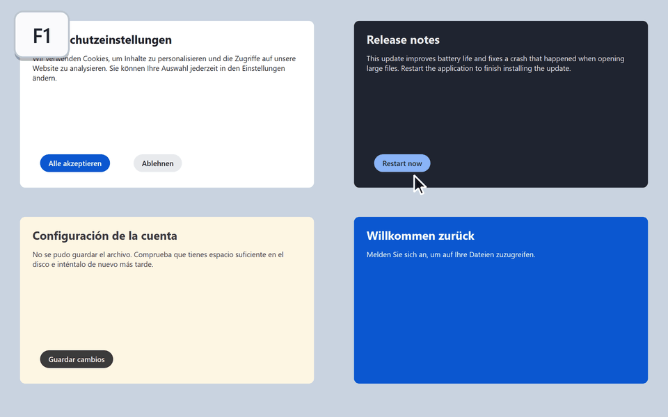

# KeepT

Made by Javier Carranza · [KettenKI](https://kettenki.com)

**Press F1. Read any language.** Finally, a use for F1.

KeepT translates the text on your Windows screen right where it is. Press the shortcut, the screen freezes, click a paragraph, and the translation appears on top of the original: same place, same colours, same size. Like a lens, but for your desktop.

No copying and pasting into a translator. No accounts, no API keys, no "please sign in to continue". And nothing ever leaves your PC.

## Get it

**[Download KeepT for Windows](https://github.com/carranza-javier/KeepT/releases)** and run `KeepT-Setup-x.y.z.exe` from the newest release (about 65 MB, Windows 10 or 11, 64-bit). No administrator rights needed.

A heads-up: Windows will probably look at the installer with suspicion ("Windows protected your PC"). That's only because it isn't signed yet, not because KeepT is up to something. Click **More info**, then **Run anyway**. If you like to double-check, every release lists the installer's SHA-256 (`Get-FileHash .\KeepT-Setup-0.10.0.exe -Algorithm SHA256` in PowerShell).

KeepT is still young, so 0.x versions come out as pre-releases. To uninstall it, go to Settings > Apps; it takes its models and settings with it.

## How to use it

While installing, you pick the language you want to read in and the languages you usually come across. The installer downloads what they need right then, so your first translation is instant.

Then press **`F1`**. Yes, the Help key. Be honest, when did you last press it on purpose? The monitor under your mouse freezes with a glowing border, and KeepT starts reading the text in the background.

| Do this | Get this |
| --- | --- |
| Click or tap a block of text | That block, translated |
| Drag a rectangle with the mouse | Everything inside it |
| Draw around text with a finger or a pen | Everything inside the loop |
| `Enter` or "Translate screen" | The whole screen |
| Click a translated block | It's copied |
| Hold `Space`, or "Original" | A peek at the original |
| `Ctrl+C` or "Copy" | All the translations, copied |
| Language button in the pill | Another target language |
| `Esc`, right click, or click outside the text | Back to work |

On laptops where F1 controls the volume or the brightness, use `Fn+F1`, or choose another shortcut from the tray icon. If another app has already taken F1, KeepT switches to `Ctrl+Alt+T` and tells you.

## What it's good at

- **Eight languages, any direction:** German, English, Spanish, French, Italian, Portuguese, Dutch and Polish. The app speaks them too.
- **Small, grey and fiddly text.** Windows finds the lines, then a small open recognizer reads every line again, so periods, accents, umlauts and "1°" come out right.
- **Numbers stay numbers.** Dates, times, amounts, e-mail addresses, links and place names come out exactly as they are on screen. A wrong date is worse than no translation, so if the model messes with one, KeepT leaves that sentence in the original.
- **It knows its place.** A translation never covers the text next to it, and items on one line ("Grüsse · salutations · saluti") stay neatly on one line.
- **Offline.** Once a language is downloaded, KeepT works without internet.

Curious about what happens under the hood? Read [How KeepT works](docs/HOW-IT-WORKS.md).

## Privacy, in short

Your screen stays on your PC. Screenshots, recognized text and translations are never sent anywhere. There's no telemetry, because we don't want to know what you're reading. KeepT only goes online to download a language you've asked for and, once a day at most, to check for a new version (you can switch that off). The details are in [Privacy](docs/PRIVACY.md).

## More reading

- [How KeepT works](docs/HOW-IT-WORKS.md): languages, models, text recognition and how numbers are protected.
- [Privacy](docs/PRIVACY.md): exactly what goes over the network, and what never does.
- [Development](docs/DEVELOPMENT.md): run it from source, the test tools, releases and the code layout.
- [Credits and licenses](docs/CREDITS.md): the models and libraries KeepT is built on.

## Code signing policy

KeepT will apply for free code signing for open source projects through SignPath Foundation. Until the signing is approved and active, releases are published unsigned (hence the SmartScreen note above). Once it is active, signed releases carry this attribution, which SignPath Foundation requires:

Free code signing provided by [SignPath.io](https://about.signpath.io), certificate by [SignPath Foundation](https://signpath.org).

- **What is signed:** only `KeepT.exe` and the `KeepT-Setup-x.y.z.exe` installer produced by the [Release workflow](.github/workflows/release.yml) of this repository, on GitHub-hosted runners, from a version tag. Nothing built on a personal computer is ever signed.
- **Team roles:**
  - Committers and reviewers: [Javier Carranza](https://github.com/carranza-javier), author and maintainer. Changes proposed by anyone else are reviewed before they are merged.
  - Approvers: [Javier Carranza](https://github.com/carranza-javier). Every signing request is approved manually.
- **Privacy policy:** see [Privacy](docs/PRIVACY.md). KeepT transfers no information about the user or the screen. Its only network requests are the model downloads and the optional update check described there, which are also explained (and can be turned off) during installation.
- Third party components keep their own licenses, are listed in [Credits and licenses](docs/CREDITS.md) and are included unsigned.

## License

KeepT is released under the MIT License (see [LICENSE](LICENSE)), © 2026 Javier Carranza. The translation models and bundled libraries keep their own licenses, listed in [Credits and licenses](docs/CREDITS.md).
